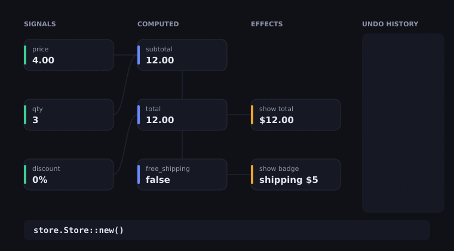

# weaver-store

**Reactive state with undo built in.** Keep your app's state in signals,
derive values from them, react to changes, and get undo/redo, transactions
and snapshots without writing a command system. No dependencies.

<p align="center">
  
</p>
<p align="center"><em>A shopping cart's live graph, drawn from <code>store.inspect()</code>. Notice that <code>show badge</code> doesn't run when <code>free_shipping</code> recomputes to the same value (<a href="examples/graph.rs">examples/graph.rs</a>).</em></p>

```toml
[dependencies]
weaver-store = { git = "https://github.com/maxmaster55/weaver-store" }
```

## In a minute

```rust
use weaver_store::Store;

let store = Store::new();

// State.
let todos = store.signal(vec!["write docs".to_string()]);
let filter = store.signal(String::new());

// Derived state: tracked automatically, lazy and cached.
let visible = store.computed(move |s| {
    let f = s.get(filter);
    s.get(todos).into_iter().filter(|t| t.contains(&f)).collect::<Vec<_>>()
});
let count = store.computed(move |s| s.get(visible).len());

// Reactions: run now and whenever what they read changes.
store.effect(move |s| println!("{} to do", s.get(count)));

// Changes. Effects run once per batch.
store.update(todos, |t| t.push("ship it".into()));
store.batch(|s| {
    s.set(filter, "ship".into());
    s.update(todos, |t| t.push("ship more".into()));
});
assert_eq!(store.get(count), 2);

// Undo and redo, with labels for your menu.
store.transaction("clear all", |s| s.set(todos, vec![]));
assert_eq!(store.undo_label().as_deref(), Some("clear all"));
store.undo();
assert_eq!(store.get(todos).len(), 3);
```

## Features

| | |
| --- | --- |
| **Signals** | `store.signal(value)` gives a `Copy` handle. `get`, `set`, `update`; setting an equal value does nothing. |
| **Computed** | `store.computed(\|s\| ...)`. Dependencies are tracked as you read, including through `if`s. Recomputes only when read after a real change, and stops propagating when the result is unchanged. |
| **Effects** | `store.effect(\|s\| ...)` re-runs when its inputs change; may set signals; `dispose` to stop. |
| **Batching** | `store.batch(\|s\| ...)`: many changes, one round of effects. |
| **Undo/redo** | Every `set` is a step; `transaction(label, ..)` groups steps; `undo`, `redo`, `can_undo`, `undo_label`, `history`, `set_history_limit`. |
| **Ephemeral state** | `store.ephemeral(value)` for hover, scroll or loading flags: reactive, but kept out of undo and snapshots. |
| **Snapshots** | `snapshot()` and `restore(&snapshot)` (undoable) for autosave, "revert to saved" or test fixtures. |
| **Untracked reads** | `peek(handle)` reads without subscribing. |
| **Dev tools** | `name(handle, "qty")` and `inspect()` list every node's kind, version, dependencies and run count. |
| **Safety** | Cycles and runaway effect loops panic with a clear message instead of hanging. |

## How it works

Each node records the version of every node it read. A change bumps the
signal's version and marks everything downstream as *maybe stale*. When a
stale computed value is read, it first checks whether any input's version
actually moved; if not, it isn't recomputed at all, and if its new result
equals the old one, its own version stays put, so nothing after it runs.
That's what keeps `show badge` quiet in the GIF.

## Works well with

[weaver_ui](https://github.com/maxmaster55/weaver_ui): keep a document's
data in a store and patch the document from an effect.

## License

MIT or Apache-2.0, at your option.
